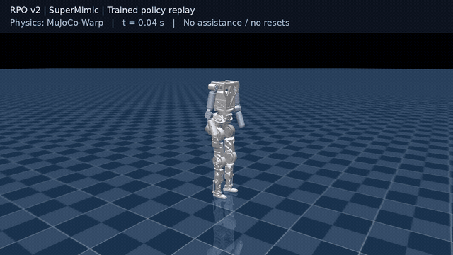
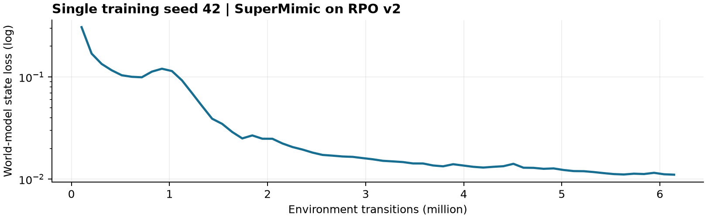

# RPO v2 SuperMimic

RPO v2 人形机器人行走与转向动作跟踪。采用可微世界模型与 Actor-Critic/BPTT，在 MuJoCo-Warp 中完成训练和闭环回放。

## 行走回放

[](https://github.com/SKLMTCHEN1/rpo-v2-supermimic-locomotion/raw/refs/heads/main/media/walk.mp4)

[完整视频 MP4](media/walk.mp4) · [评估记录](results/evaluation.json) · [训练日志](checkpoints/metrics.jsonl)

## 实现

- **机器人配置**：23 自由度 RPO URDF、浮动基座、速度传感器、分组 PD 与力矩限幅。
- **动作处理**：Isaac / MuJoCo 关节序映射、四元数 SLERP、50 Hz 重采样、坐标归一化与足部 FK 检查。
- **训练流程**：1,024 个并行环境，世界模型与策略交替优化，保存权重、配置和训练指标。
- **评估回放**：从参考首帧起步，记录首次终止、根部误差与物理轨迹，导出 720p 视频。

## 结果

| 指标 | 数值 |
| --- | --- |
| 训练环境交互 | 6,145,024 次 |
| 训练硬件 | 单张 RTX 5090 D v2 |
| 完整动作评估 | 8 / 8 个随机化仿真实例通过 |
| 行走时长 | 5.76 s，288 步 |
| 演示水平净位移 | 6.58 m |
| 合计根部位置 RMSE | 0.1224 m |
| 模型与状态表征检查 | 21 项通过 |

评估对象为单段行走与转向参考动作。训练 seed 42，评估 seed 123；策略周期 20 ms，物理步长 5 ms。



## 代码入口

| 文件 | 内容 |
| --- | --- |
| [rpo.py](src/supermimic/tasks/rpo.py) | 机器人、执行器与任务配置 |
| [prepare_walk.py](scripts/prepare_walk.py) | 动作转换与重采样 |
| [train_rpo.py](scripts/train_rpo.py) | 并行训练与结果保存 |
| [evaluate_rpo.py](scripts/evaluate_rpo.py) | 策略评估与视频导出 |
| [checkpoints](checkpoints) | 最终 actor、运行配置与训练日志 |

## 运行

Python 3.13，NVIDIA GPU。将 [mjlab_research](https://github.com/HybridRobotics/mjlab_research) 放在同级目录：

```bash
git clone https://github.com/HybridRobotics/mjlab_research.git ../mjlab_research
git -C ../mjlab_research checkout dd51a9fcc98791a2f0b018b3c7f71a3eefd5ecdd
uv sync
```

准备 RoboLab 的 `B14_-__Walk_turn_right_45_t2_stageii.pkl`，来源与关节序见 [motion-provenance.json](data/motion-provenance.json)。

```bash
PYTHONPATH= .venv/bin/python scripts/prepare_walk.py --source /path/to/B14_-__Walk_turn_right_45_t2_stageii.pkl
PYTHONPATH= WANDB_MODE=offline MUJOCO_GL=egl .venv/bin/python scripts/train_rpo.py --steps 6001 --num-envs 1024
PYTHONPATH= MUJOCO_GL=egl .venv/bin/python scripts/evaluate_rpo.py --run checkpoints --video
```

检查模型与动作：

```bash
PYTEST_DISABLE_PLUGIN_AUTOLOAD=1 PYTHONPATH= .venv/bin/python -m pytest -q
```

## 依赖与许可

[SuperMimic](https://github.com/HybridRobotics/supermimic) · [mjlab](https://github.com/HybridRobotics/mjlab_research) · [RoboParty RPO](https://github.com/Roboparty/rpo_description)

代码采用 [Apache-2.0](LICENSE)，RPO 模型采用 [CERN-OHL-W-2.0](assets/rpo/LICENSE)。
